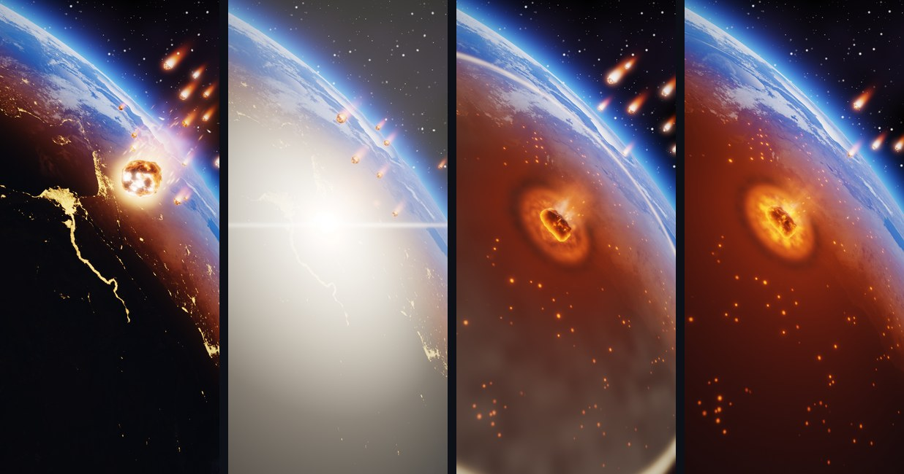

# Extinction Event

An Android live wallpaper: a meteor closes in on Earth while your phone is locked, and strikes the
moment you unlock it.



<sub>On the lock screen · the impact · eight seconds later · two minutes later.</sub>

## What it does

- **Locked:** the meteor approaches, burning, with a swarm of smaller fragments, and holds just
  short of the atmosphere for as long as the phone stays locked. On One UI, dragging the lock
  screen makes it close in faster.
- **Unlock:** it dives and strikes. A white flash and a lens streak, a shock front racing across
  the surface, city lights going dark as it passes, clouds blown outward, fires igniting, and a
  fireball that cools into smoke.
- **Aftermath:** the rock lies half buried and glowing in its crater while fragments keep raining
  down. The scene settles into a calm loop on the home screen.
- The Earth is real: NASA imagery for the land, the night lights and the clouds, lit by a sun
  with a terminator, an atmosphere and slowly drifting clouds.

Every effect is drawn live in GLSL. Nothing is a video.

## Requirements

- Android 14 (API 34) or later.
- OpenGL ES 3.0 with half-float render targets (any recent phone).

It works with any launcher. One lock-screen extra, the drag boost, uses signals only One UI
(Samsung) sends; see [how it works](#how-it-works).

### Tested on

| | |
|---|---|
| Device | Samsung Galaxy S24 Ultra (SM-S928B) |
| System | Android 17 (API 37), One UI 9 |
| Display | 1440 × 3120 (QHD+), 120 Hz; the wallpaper renders at 810 × 1755 |
| GPU | Adreno 750, OpenGL ES 3.2 |

The app targets API 36 and runs from API 34 up.

## Install

There is no store release yet: build it from source with the Android SDK and JDK 21 or later.

```sh
git clone https://github.com/mnesimiyilmaz/extinction-event.git
cd extinction-event
./gradlew installDebug
```

Then open **Extinction Event** from the app drawer: it shows the wallpaper in the system preview,
where you apply it to the home and lock screens. (Some launchers, One UI's among them, do not list
third-party live wallpapers in their own wallpaper settings; the app icon is the way in.) From a
computer, the same preview opens with:

```sh
adb shell am start -a android.service.wallpaper.CHANGE_LIVE_WALLPAPER \
  --ecn android.service.wallpaper.extra.LIVE_WALLPAPER_COMPONENT \
  io.github.mnesimiyilmaz.extinction/.wallpaper.ExtinctionWallpaperService
```

The debug build logs frame statistics and accepts the developer broadcasts described below. For
daily use, build `./gradlew assembleRelease` and sign the APK with your own key.

## How it works

### Lock screen and unlock

A live wallpaper is not told about the lock screen directly. Extinction Event works it out from
the signals the system does send:

- Screen on: the `android.wallpaper.wakingup` command and `ACTION_SCREEN_ON`.
- Unlock: `KeyguardManager.isKeyguardLocked()` turning false, polled on rendered frames while the
  meteor approaches (`USER_PRESENT` does not reach the wallpaper on One UI). Face or fingerprint
  recognition that leaves you on the lock screen does not count.
- Screen off: `ACTION_SCREEN_OFF` resets the scene for the next screen-on.
- One UI sends `samsung.android.wallpaper.pause` / `resume` while the lock screen is dragged;
  they drive the drag boost. Other launchers simply never send them.

These feed a small state machine: `OFF → APPROACH → DIVE → IMPACT → AFTERMATH`. It is pure Kotlin
and unit-tested against shared test vectors.

### Rendering

OpenGL ES 3.0 on a dedicated render thread, paced by `Choreographer`:

1. **Background:** stars, the Earth, clouds and atmosphere, cached and re-rendered at 10 Hz. Between
   refreshes it is moved with the camera's slow sway, so it still glides every frame.
2. **Impact layer:** shock front, condensation and dust bands, ejecta, fires, crater, smoke and
   fireball.
3. **Fragments:** instanced quads, each bounding one ray-marched rock and its trail.
4. **Meteor:** a ray-marched rock with a plasma sheath and a turbulent trail. After the impact its
   geometry is cached, because it no longer moves, and only its molten surface is re-lit per frame.
5. **Sparks, embers and the flash,** then a dual-Kawase bloom, heat distortion, ACES tone mapping,
   vignette and dither.

Particles are analytic functions of time: nothing is simulated or stored, so any moment can be
rendered exactly. The scene renders at 75% of a 2340-pixel-tall frame into a wallpaper surface of
that size, which the display hardware scales up for free.

### Battery

It renders only while the wallpaper is visible: nothing with the screen off or an app open. The
frame rate is capped at 60 fps while the meteor approaches and strikes, 30 fps in the aftermath,
and 20 fps once the impact is 30 seconds old.

Measured on the Galaxy S24 Ultra (home screen, brightness 47%), against the same frame held still,
the wallpaper adds about 126 mA at 30 fps and 80 mA at 15 fps. That is roughly 2.5% and 1.6% of the
battery per hour spent looking at the home screen; the 20 fps steady state sits between the two.

## Tuning

Everything that shapes the look and the timing lives in
[`app/src/main/assets/config/tuning.json`](app/src/main/assets/config/tuning.json): durations,
camera, colours, particle counts, bloom, frame-rate caps and more. Each key `fooBar` reaches the
shaders as the uniform `uFooBar`. Colours are given in sRGB hex and converted to linear.

Some useful ones:

| Key | Default | Effect |
|---|---|---|
| `pHold` | 0.85 | How close the meteor gets while the phone stays locked (0–1). |
| `tau` | 3 | Seconds to close most of that distance. |
| `dragBoost` | 4 | Approach speed-up while the lock screen is dragged (One UI). |
| `chunkCount` | 15 | Fragments alongside the meteor (up to 24). |
| `impactLatLon` | 29.5, 33.8 | Where it strikes (Sinai). Needs new Earth textures, see [CREDITS.md](CREDITS.md). |
| `renderScale` | 0.75 | Render resolution. Lower is faster and softer. |
| `fpsActive` / `fpsIdle` / `fpsSettled` | 60 / 30 / 20 | Frame caps: approach and impact, aftermath, settled. |
| `settleAfter` | 30 | Seconds after the impact before the settled cap applies. |
| `bloomStrength`, `exposure`, `vignette` | | Final grade. |

## Development

```
app/src/main/
  assets/shaders/     GLSL ES 3.00 sources (common.glsl and bodies.glsl are included by the rest)
  assets/config/      tuning.json
  assets/earth/       Earth textures (see CREDITS.md)
  kotlin/.../scene/   the state machine and the wallpaper-signal driver
  kotlin/.../render/  EGL, the render pipeline, scheduling, GPU timers
  kotlin/.../wallpaper/ the WallpaperService and its render loop
app/src/test/         JVM tests: state machine, scheduling, scene constants, shader lints
app/src/androidTest/  on-device tests, benchmark, scene dumps
tools/                device and asset scripts
docs/                 architecture notes
```

Tests:

```sh
./gradlew testDebugUnitTest         # JVM: state machine, scheduling, shader lints
tools/device-test.sh GlDeviceTest   # device: shaders compile, textures upload, GPU timers
```

The debug build has tools for working on the look and performance on a device (an emulator with
GPU acceleration should do for the look, though it is untested):

- **Hold a moment:** `adb shell am broadcast -p io.github.mnesimiyilmaz.extinction -a
  io.github.mnesimiyilmaz.extinction.DEBUG_SCRUB --ef t 14.6` freezes the scene 14.6 s into the
  canonical sequence (screen on locked at 0 s, unlock at 6 s); `-1` resumes.
  `tools/device-shot.sh <dir> 2 6.3 14.6` takes screenshots at several moments.
- **Before/after:** `tools/scene-dump.sh <dir>` renders fixed moments off screen exactly as the
  wallpaper does; `python3 -I tools/compare-shots.py <before> <after>` compares two dumps.
- **Frame rate:** `DEBUG_FPS` with `--ef fps 20` overrides the caps live (0 pauses, -1 resets).
- **GPU cost:** `tools/device-test.sh GpuBenchmark -e benchmark true` times every pass at fixed
  moments (results in `adb logcat -s ExtinctionBench`). The running wallpaper also logs fps, GPU
  time per pass and battery current under the tag `Extinction`.

Shader edits take effect with `./gradlew installDebug`. [`docs/architecture.md`](docs/architecture.md)
describes the signals, the state machine, the shader contract and the render passes.

## Credits

Earth imagery: NASA Earth Observatory and NASA Visible Earth, public domain. Details in
[CREDITS.md](CREDITS.md).

## License

Copyright © 2026 mnesimiyilmaz

Extinction Event is free software: you can redistribute it and/or modify it under the terms of the
[GNU General Public License](LICENSE) as published by the Free Software Foundation, either version 3
of the License, or (at your option) any later version. Anything built from it must stay open
source under the same terms. The NASA imagery keeps its public-domain status
([CREDITS.md](CREDITS.md)).
